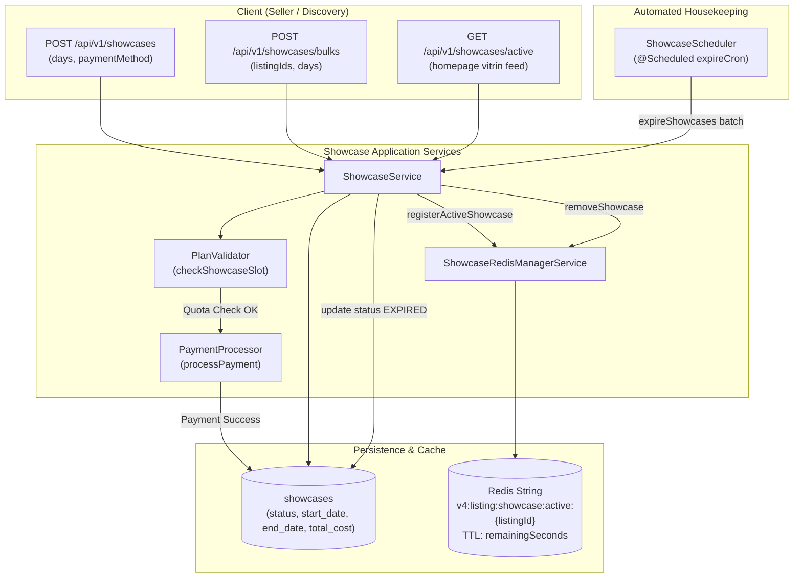

# Showcase Domain

## 1. Executive Summary & Purpose
The `showcase` domain governs the paid "vitrin" (showcase) promotional features of the marketplace. It allows sellers to boost listing visibility on the homepage and category discovery feeds for a user-specified duration (in days), supporting extensions, early cancellations, and automated expiration.

### Core Architectural Responsibilities
- **Paid Listing Promotion:** Computes daily costs plus applicable taxes and executes payment capture via `PaymentProcessor`.
- **Plan Quota Enforcement:** Validates user membership tier (`BASIC`, `PLUS`, `PRO`) showcase slot quotas via `PlanValidator.checkShowcaseSlot`.
- **High-Performance Redis Registry:** Maintains active showcase keys in Redis (`v4:listing:showcase:active:{listingId}`) with exact TTL matching showcase expiration, allowing lightning-fast feed filtration without hitting PostgreSQL.
- **Batch Enrichment:** `ShowcaseMapper` enriches listing feeds with favorite counts and campaign pricing in single round-trips to eliminate N+1 database queries.
- **Scheduled Expiration:** `ShowcaseScheduler` monitors and transitions expired showcases in batch.

---

## 2. Architecture & Lifecycle Flow

---

## 3. Core Entities & Database Schema

### `showcases` Table
- `id` (UUID, PK)
- `listing_id` (UUID, FK -> `listings.id`, not null)
- `user_id` (BIGINT, FK -> `users.id`, listing seller)
- `status` (VARCHAR(20), maps to `ShowcaseStatus`: `ACTIVE`, `EXPIRED`, `CANCELLED`)
- `start_date` (TIMESTAMP, not null)
- `end_date` (TIMESTAMP, not null, indexed)
- `total_cost` (NUMERIC(12,2), not null)
- `created_at` / `updated_at` (Timestamps)

---

## 4. Business Invariants & Lifecycle Mechanics

### 4.1 Creation & Plan Quota Check
1. **Days Validation:** Validates requested promotion days against `ShowcaseValidator.validateDaysCount(days)` (must be positive and within allowed maximum).
2. **Membership Quota:** Calls `showcaseRepository.countActiveByUserId(userId)` and verifies against `PlanValidator.checkShowcaseSlot(user, currentSlotCount)`. If the seller's plan quota is exceeded, an error is returned.
3. **Pricing & Tax Calculation:**
   $$\text{DailyCostWithTax} = \text{dailyCost} \times (1 + \text{taxRate})$$
   $$\text{TotalCost} = \text{DailyCostWithTax} \times \text{days}$$
4. **Synchronous Payment Capture:** Constructs `PaymentRequest` and calls `PaymentProcessor.processPayment(...)`. The showcase entity is persisted only after payment confirmation.
5. **Redis Registry:** Registers the active showcase in Redis:
   - Key: `v4:listing:showcase:active:{listingId}`
   - Value: `showcaseId`
   - TTL: $\Delta t$ between `LocalDateTime.now()` and `endDate`.

### 4.2 Extensions & Cancellations
- **Extension (`POST /{id}/extend`):** Requires seller ownership. Verifies status is `ACTIVE`. Calculates incremental cost for additional days, charges seller via `PaymentProcessor`, extends `endDate`, and updates the Redis TTL.
- **Cancellation (`POST /{id}/cancel`):** Marks status as `CANCELLED` and immediately deletes the Redis key (`removeShowcase`).
- **No-Refund Policy:** By platform business rules, early cancellation of a showcase does not issue an automated refund.

### 4.3 Automated Expiration (`ShowcaseScheduler`)
- Executes on cron schedule configured via `showcaseConfig.scheduler.expireCron`.
- Queries showcases where `status = 'ACTIVE'` and `end_date <= :now`.
- Bulk-updates statuses to `EXPIRED` and prunes Redis cache references.

---

## 5. Public REST API Specifications

| Method | Endpoint | Auth | Purpose | Response |
|---|---|---|---|---|
| `POST` | `/api/v1/showcases` | Bearer | Create showcase for a single listing | `ShowcaseDto` |
| `POST` | `/api/v1/showcases/bulks` | Bearer | Create showcases for multiple listings in batch | `List<ShowcaseDto>` |
| `GET` | `/api/v1/showcases/active` | Public | Paginated active showcases for homepage vitrin | `Page<ShowcaseDto>` |
| `GET` | `/api/v1/showcases/my` | Bearer | All showcases owned by authenticated user | `List<ShowcaseDto>` |
| `POST` | `/api/v1/showcases/{id}/extend` | Bearer | Extend duration of active showcase | `204 No Content` |
| `POST` | `/api/v1/showcases/{id}/cancel` | Bearer | Cancel active showcase early (no refund) | `204 No Content` |
| `GET` | `/api/v1/showcases/pricing-config` | Public | Daily fees, tax rates, and duration options | `ShowcasePricingDto` |

---

## 6. Error Codes

Defined in `ShowcaseErrorCodes`:
- `SHOWCASE_NOT_FOUND`: Showcase record does not exist.
- `SHOWCASE_NOT_OWNED`: IDOR attempt; user does not own the showcase.
- `SHOWCASE_ALREADY_ACTIVE`: Listing already has an active showcase.
- `SHOWCASE_DAYS_INVALID`: Requested days outside permitted min/max limits.
- `SHOWCASE_PAYMENT_FAILED`: Payment transaction declined.
- `SHOWCASE_SLOT_LIMIT_EXCEEDED`: User membership plan quota reached.
