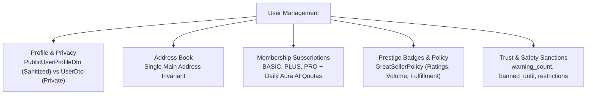

# User Domain

## 1. Domain Scope & Purpose
The `user` domain manages user identities, privacy-governed public and private profiles, physical shipping/billing addresses, subscription tiers (`BASIC`, `PLUS`, `PRO`), daily Aura AI query quotas, prestige seller badge eligibility ("Great Seller"), and Trust & Safety sanction states.

> [!NOTE]
> **Related Documentation & Runbooks:**
> - **Architecture Deep Dive:** [`docs/auth-jwt-and-security-architecture.md`](../../../../../../../docs/auth-jwt-and-security-architecture.md)
> - **Architecture Deep Dive:** [`docs/multi-tier-redis-caching-and-invalidation.md`](../../../../../../../docs/multi-tier-redis-caching-and-invalidation.md)
> - **Frontend Module:** [`secondhand-frontend/src/user/README.md`](../../../../../../../secondhand-frontend/src/user/README.md)

---

## 2. Step-by-Step Subsystem Lifecycles

### 2.1. User Profile & Data Protection
* **Private Identity:** Authenticated users access their own detailed data (`UserDto`) containing email, phone, birthdate, gender, roles, and addresses.
* **Public Profile Sanitization (`GET /api/v1/users/{id}`):** External users, buyers, or forum participants only receive `PublicUserProfileDto`. Sensitive attributes (email, phone, birthdate, password hashes, internal roles, and sanction details) are strictly omitted. Only public listings in `ListingStatus.ACTIVE` are visible on a user's storefront.

### 2.2. Address Book Management (`AddressService`)
* Users maintain multiple shipping/billing addresses in the `addresses` table.
* **Single Main Address Invariant:** Exactly one address may carry `isMain = true` at any given time. Setting an address as main atomically demotes any previously designated main address within the same transaction (`addressRepository.demoteExistingMainAddress`).

### 2.3. Membership Tiers & Daily Aura AI Quotas (`MembershipService`)
* **Plans:** `MembershipPlan.BASIC` (free default), `MembershipPlan.PLUS`, `MembershipPlan.PRO`.
* **Aura AI Integration:** Each plan defines a daily question ceiling. The system increments `daily_aura_questions_used` upon each query. If the quota is exceeded, the AI gateway halts with `403 Forbidden` (`AURA_LIMIT_EXCEEDED`).
* **Automated Schedulers (`MembershipScheduler`):**
  - **Daily Quota Reset:** Runs every midnight (`cron = "0 0 0 * * *"`) resetting `daily_aura_questions_used = 0` for all users.
  - **Billing & Expiration:** Runs daily checking subscriptions where `membershipExpiresAt < NOW()`. If `autoRenew == true`, attempts to charge the user's eWallet; if renewal fails or auto-renew is off, downgrades the plan to `BASIC`.

### 2.4. Prestige Seller Engine ("Great Seller")
* Governed by `GreatSellerPolicy` and `GreatSellerService`.
* Criteria evaluate lifetime completed orders, fulfillment speed, dispute ratio, and review score ($\ge 4.5/5.0$).
* **Event-Driven Recalculation:** `GreatSellerEligibilityEventListener` listens to `SellerEligibilityRecheckEvent` (triggered after order completions or reviews) and schedules asynchronous background re-evaluations without blocking core order checkout threads.

### 2.5. Trust & Safety Moderation States
* Holds disciplinary fields populated by Aura AI moderation:
  - `warning_count`: Official warning counter (3 warnings trigger 7-day suspension).
  - `banned_until`: Expiration timestamp of temporary restrictions.
  - `is_chat_restricted`, `is_listing_restricted`: Action guards checked via Redis cache (`v4:user:restriction:{userId}`).
  - **180-Day Strike Decay:** If 180 consecutive days elapse since `last_penalized_at` with zero new infractions, `warning_count` is reset to 0 via lazy evaluation.

---

## 3. Business Invariants & Constraints

* **Strict Uniqueness:** `email` and `phone` must be globally unique across all active accounts.
* **Non-Demotable Own Listings:** Users are prevented from purchasing, favoring, or reviewing their own listings.
* **Fiduciary Preservation:** Banned accounts retain rights to pending escrow payouts and balance withdrawals; only platform listing/showcase fees are non-refundable.

---

## 4. Database Schema & Flyway Structure

* **`users` Table:**
  - `id`: BigInt primary key.
  - `email`, `phone`, `password`, `first_name`, `last_name`.
  - `account_status`: Enum (`ACTIVE`, `PENDING_VERIFICATION`, `SUSPENDED`, `BLOCKED`, `DELETED`).
  - `role`: Enum (`BUYER`, `SELLER`, `ADMIN`).
  - `membership_plan`: Enum (`BASIC`, `PLUS`, `PRO`).
  - `daily_aura_questions_used`: Integer tracking AI usage.
  - `warning_count`, `banned_until`, `restriction_reason`, `last_penalized_at`, `is_chat_restricted`, `is_listing_restricted`.
* **`addresses` Table:**
  - `id`: BigInt primary key.
  - `user_id`: Foreign key to `users`.
  - `title`, `address_line1`, `address_line2`, `city`, `district`, `postal_code`, `is_main`.

---

## 5. Public REST API Contracts

### Profile Operations (`UserController` — `/api/v1/users`)
* **`GET /me`:** Full private profile of authenticated user.
* **`GET /{id}`:** Sanitized public profile (`PublicUserProfileDto`).
* **`GET /{id}/listings`:** Active storefront listings for a user.
* **`PUT /email`:** Updates email address (requires re-verification).
* **`PUT /phone`:** Updates phone number.
* **`GET /great-sellers`:** Directory of top-rated platform sellers.
* **`GET /{id}/great-seller-status`:** Detailed metrics breakdown for Great Seller status.

### Address Book (`AddressController` — `/api/v1/users/addresses`)
* **`GET /`:** Lists saved addresses for current user.
* **`POST /`:** Adds a new shipping address.
* **`PUT /{id}`:** Modifies address details.
* **`DELETE /{id}`:** Deletes an address.
* **`POST /{id}/main`:** Designates an address as primary.

### Memberships (`MembershipController` — `/api/v1/memberships`)
* **`GET /status`:** Returns active plan tier, auto-renew flag, and daily Aura AI quota usage.
* **`POST /upgrade`:** Changes subscription plan (`MembershipUpgradeRequest`).
* **`POST /cancel`:** Disables auto-renewal for current period.
* **`POST /toggle-auto-renew`:** Toggles auto-renewal state.

### Prestige Badges (`UserBadgesController` — `/api/v1/user/badges`)
* **`GET /`:** Returns all badges earned by the authenticated user.
